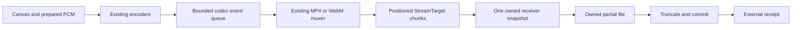

# External MP4/WebM output: design and verification prototype

Status: repository research, 2026-11-14, based on CanvasTake **0.8.1** / commit
`1859e9a83f8a3f01a94ec55331efeabcf54684b7`. No public API, codec, container profile,
runtime source, dependency, export map or package-version change. The
[draft contract](external-video-output-api.d.ts) is not a package entry point.

## Why investigate a destination

The current MP4/WebM adapters already write incrementally through Mediabunny 1.65.0
`StreamTarget`, but copy all positioned writes into owned 64 KiB pages. They retain the logical
output until constructing a Blob, then clear page references. The controller requires a nonempty
MIME-matching Blob from `muxer.finalize()` and returns `result.blob`. External output therefore
needs a deliberate result-contract change; returning a fake Blob is not a compatible solution.

Output pages are only one memory source. A destination does not remove the scene/canvas,
captured RGBA, native VideoFrames/codec state, callback packets, controller queues, sample tables,
cues, vendor staging, final metadata, OS file cache or downstream copies. Prepared PCM is copied
by the controller: 48 kHz Float32 mono costs 192,000 bytes per second per retained copy; stereo
doubles it, and caller retention can keep the original alongside the snapshot.

The [memory report](video-output-memory-study.md) distinguishes process measurements from exact
receiver/page ownership counters. Constant receiver capacity is not constant total RAM.

## Positioned destination contract



The proposed boundary is `ready(signal)`, `writeAt(position,data,signal)`, `truncate(size)`,
`commit()` and `abort(reason)`. Acquire a fresh exclusive destination per export. Pre-abort
should precede acquisition; an acquisition finishing during abort must still release its handle.
Caller-owned existing files need an explicit overwrite policy. This proof only creates new files
in its own workspace.

1. **Positions/bounds:** nonnegative safe integer positions/endpoints, inclusive output and
   per-write budgets checked before copying/I/O. Size is the high-water written endpoint,
   separate from traffic. Overlaps are last-write-wins; rewinding does not shrink the file.
   Empty writes are validated no-ops.
2. **Ownership:** snapshot the exact supplied view before yielding. Never retain an unrelated
   caller backing buffer. Retain only this owned copy until physical I/O completes, even if
   logical cancellation rejects earlier. Reject overlapping direct calls rather than adding an
   unbounded queue; the owned WritableStream serializes actual sink calls.
3. **Capacity:** await `ready(signal)` before starting I/O. Readiness listeners/timers should
   observe the internal cancellation signal. Write completion releases borrowed bytes; it is not
   an fsync/durability guarantee. Input buffers may be mutated after receiver admission because
   the receiver owns its snapshot.
4. **Completion:** drain the container writer, truncate to high-water size, then commit. Only a
   successful commit yields frozen `{kind:'external-output',type,size,handle}`. Repeated finish
   uses the same Promise; committed output survives late abort/disposal.
5. **Failure:** preserve the first receiver-observed reason/error, including falsy reasons.
   Logical rejection can precede physical cleanup. `settled()` fences logical work, physical I/O
   and cleanup; remove/close must wait for non-cancellable writes. Cleanup errors are diagnostics
   and never replace the primary error. No late operation starts after termination.

Direct input/overlap validation rejects that call before I/O; the enclosing muxer/controller
owns the session's terminal transition. Actual ready/write/truncate/commit failures terminate
the receiver and release the destination. Crashes, abandoned partial-file recovery and user-visible
rollback require destination-specific policy. A close-completed file is not necessarily durable.

### Destinations in this proof

- Node: exclusive `.partial`, positional `FileHandle.write` loop (including short/zero-progress
  writes), truncate/close and rename to a new owned path; abort closes/removes owned output.
- Chromium: a unique OPFS file and `FileSystemWritableFileStream.write({type:'write',position,data})`,
  truncate and close, inside a fresh persistent profile. The driver verifies its physical backing
  file size before download. Abort removes it; a receipt identifies the file and the study retains
  its corresponding handle for validation/download. Incognito OPFS is kept as a separate
  memory-backed control, not treated as disk storage.

Neither is a user file picker, HTTP upload or production storage API. Commit/abort races can remove
the proof's own newly created file; this does not prove rollback for arbitrary external destinations.

## Seek and backpressure in the pinned writer

Both current regular-container layouts rewrite bytes. Node tests compare entire MP4/WebM files
against unchanged Blob adapters for identical coded input, with/without audio and with header
rewrites. Append-only destinations deliberately reject a rewind instead of returning corrupt success.

The official [writing guide](https://mediabunny.dev/guide/writing-media-files) documents positioned
chunks and WritableStream backpressure. This proof also inspects **pinned 1.65.0** `target.js`:
flush assembles a chunk before awaiting capacity and posts `writer.write()` without awaiting that
individual Promise. The next capacity check and final `writer.close()` are the subsequent fences.
Start or one source operation can therefore finish while one write is pending. Acknowledgement
is not physical persistence.

The prototype returns the actual receiver Promise from the sink callback. Receiver guards expose
asynchronous errors; the adapters retain their endpoint/timeline guards. Observational target
listeners are not error propagation channels. A receiver chunk cap cannot prevent an oversized
vendor allocation which occurred before the callback.

Append-only output needs an explicit alternate profile, such as fragmented MP4, with separate
seeking, duration, audio trimming and player checks. The official
[format discussion](https://mediabunny.dev/guide/output-formats) describes the distinction. It is
outside this proof of the current regular MP4/WebM layouts.

## Experimental build and future result API

[build.mjs](../../scripts/video-output-study/build.mjs) creates isolated bundles under ignored
`benchmark-results/`. Every source transform requires exactly one match; source drift fails.
Original source and harness hashes are recorded. Ordinary source/shipped adapters are untouched.

- Baseline retains the existing controller, encoders, adapters and page store, adding numerical
  ownership counters without retaining data references.
- External replaces the store bridge, returns its write Promise, checks its asynchronous failure,
  and returns a committed receipt. Existing format/audio/timeline rules and the guarded WebM
  integration patch remain in the original adapter bodies.
- Only the research controller's Blob validation/result projection accept a receipt. This is a
  guarded proof, not a typechecked production refactor or an implemented public overload.
- Container creation time/random identifiers are fixed in both bundles. The performance clock,
  native encoders and browser/OS memory are real and unmodified.

A future API should opt in explicitly to a destination-capable muxer/result specialization.
Default `createOfflineVideoExporter` and custom Blob factories keep the current Blob result,
Promise identity, errors, cleanup and progress meanings. Unsupported destinations must fail
capability checks rather than silently fall back. Public overload names and the precise factory
acquisition/ownership point remain later implementation decisions; this draft defines only the
receiver/receipt boundary.

## Compatibility gates before public implementation

| Gate | Required evidence |
| --- | --- |
| E1 | Default Blob API/types and existing custom muxers unchanged |
| E2 | Backward/overlapping/subview/short writes, high-water size and inclusive bounds |
| E3 | Same regular-container bytes for identical coded input/deterministic metadata |
| E4 | Readiness and stream closure propagate pressure without an additional unbounded queue |
| E5 | Abort before acquisition and during ready/write/commit; cleanup fence, no late writes |
| E6 | First cause/reason retained, cleanup errors secondary, no unhandled late rejection |
| E7 | Independent full decode, final hold, A/V sample count and timeline |
| E8 | No receipt/owned partial file after failure; fresh export succeeds |
| E9 | Distinguish logical rejection, buffer ownership, native caches and process totals |
| E10 | Native non-awaitable callback bursts stay bounded with slow output, including Opus flush |
| E11 | Matched workload/output memory comparison; metadata/PCM growth remains explicit |
| E12 | Public/installed/Next gates after a separately authorized implementation |

The Opus small-queue observation is a real E10 constraint: a slow destination can exhaust the
current output-event budget. A separate budget/latency experiment records outcomes. Short A/V
success checks explicitly use a larger existing budget, without changing the library default or
certifying every latency at that budget. Video-only memory success alone does not establish
readiness for public external-output support.

Follow-up, unreleased correction (2026-11-14): the
[Opus backpressure correction and verification](opus-backpressure-verification.md) addresses the
observed E10 overflow with ordinary limits. The earlier memory data remains unchanged historical
evidence; acquisition, committed-result ownership and public API integration gates remain separate.

## Commands

```sh
npm run test:video:output
npm run benchmark:video:output -- --quick
npm run benchmark:video:output
```

Full study: Chromium, 640×360/24 fps, 60/180 seconds plus a 250 ms final hold, Blob/OPFS and both
formats, three repeats with alternating target order, six failure/cancel/retry controls, five
Opus budget probes and four short real A/V cases. The controlled noise scene is expensive to
compress: report actual bytes, not just the requested bitrate. Browser permission rules and the
two-agent-page limit apply. All output is local; no publication is part of this stage.
