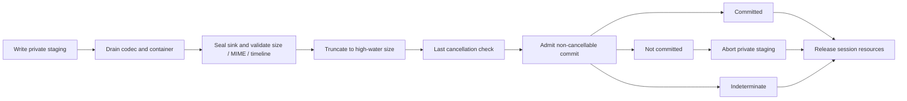

# Public external MP4/WebM output: proposed API

Status: **design only**, started 2026-11-14, verified 2026-11-16, based on 0.8.1 / commit
`efc5f66f8d03168a7f99945ccb4f2d1f2062a25c`. No public runtime implementation or exports,
package/version change or release. The proposed names below are unavailable in the current package.
The [declarations](external-video-public-api.d.ts), [compile-only example](external-video-public-example.ts)
and [compatibility criteria](external-video-public-compatibility.md) specify the next implementation.
The [verification record](external-video-public-verification.md) separates design/type checks from
the future runtime gates.
The earlier [receiver prototype](external-video-output.md) and [Opus correction](opus-backpressure-verification.md)
are evidence, not implementations of this public lifecycle.

Private follow-up (2026-11-17): the controller is now implemented only under `src/internal`,
with controlled destinations/muxers for P1–P23; see the
[private-controller verification](external-video-controller-verification.md). Public entry points
and concrete production filesystem adapters remain separate stages. The later
[private real-container verification](external-video-containers-verification.md) connects
MP4/WebM and tests actual-file policies on a controlled local filesystem; it exposes no public API.

Production contract refinement (2026-11-20): [capabilities and independent attempt recovery](external-video-destination-contract.md)
clarify read-only preflight, publication policies and reconciliation after thrown/unknown commit.
The core signatures below are unchanged; richer diagnostics/recovery are adapter/application-side
design artifacts. The existing test file receiver is not a production implementation of that contract.
The subsequent [private OPFS browser prototype](external-video-browser-prototype.md) verifies
catalogue-based creation/replacement and real media writes; it adds no public entry or native
user-folder guarantee.

## Selected shape

```ts
// PROPOSED API ONLY. Current CanvasTake does not export these additions.
const exporter = createExternalVideoExporter({
    video: { encoder, config },
    muxer: createMp4Muxer({ output: 'external' }),
    destination: applicationDestination, // factory, not an already-open stream
    ifExists: 'error',                  // default; replace must be explicit
    signal
});
try {
    await exporter.ready;
    await exporter.addFrame(canvas, { timestampUs: 0, durationUs: 1_000_000 });
    const result = await exporter.finish();
    useCommittedValue(result.output.value);
} finally {
    exporter.dispose();
    const report = await exporter.closed;
    inspectCleanupIssues(report.cleanupIssues);
}
```

The new synchronous `createExternalVideoExporter` is proposed for `/video`. The handle exists
before asynchronous initialization starts, so cancellation or a failed/late acquisition still has
an observable cleanup fence. Invalid options or a pre-aborted signal can throw synchronously;
that path performs no acquisition. `ready` is initialization only; it does not certify later liveness.
Calls to add/finish before ready reject without queueing frames. Prepared PCM validation/snapshot
still happens synchronously before the first asynchronous initialization step.

`createOfflineVideoExporter` and the no-argument MP4/WebM factories keep their exact Blob contracts.
The new explicit `{output:'external'}` overload selects a destination-capable muxer. It has no
implicit Blob/in-place/append fallback. Custom encoders keep their existing contracts. A custom
external muxer implements the new metadata-only protocol; an existing Blob muxer is not cast or
duck-typed into that protocol. `format` remains mandatory.

| Proposed location | Addition | Existing behavior |
| --- | --- | --- |
| `/video` | `createExternalVideoExporter`, external contracts | Existing controller/types stay Blob-only |
| `/video/mp4` | `createMp4Muxer({output:'external'})` | `createMp4Muxer()` stays unchanged |
| `/video/webm` | `createWebmMuxer({output:'external'})` | `createWebmMuxer()` stays unchanged |
| No entry yet | Application-supplied destination factory | No promised universal file-picker/Node/OPFS helper |

Same-name overloads returning a Promise in one mode and a synchronous session in another were
rejected: `await` would hide the missing ready step. An always-async constructor would lose the
cleanup handle on early rejection unless all non-cancellable acquisition was awaited before
reporting cancellation. The separate constructor preserves the old API and makes both barriers explicit.

## Acquisition and ownership before publication

1. Reject a pre-aborted signal before PCM allocation or external acquisition, then validate
   options/factory shapes/numeric bounds and synchronously snapshot PCM. Synchronous validation
   failure owns no external resources.
2. Return the handle, attach cancellation and start asynchronous initialization in a later microtask.
   Preflight video/audio/muxer and `destination.checkSupport(request)` before opening a writer.
   Support checks are read-only and must not show pickers, truncate files or reserve a transaction.
3. Call destination `create(context)` once per session. Its request contains the exact format,
   resolved `ifExists`, existing optional `maxOutputBytes` and `maxWriteBytes = maxPendingBytes`
   (default 16 MiB). This last field is a resolved per-write bound, not a new user option.
4. Register the pending acquisition before awaiting it. Ownership of a returned transaction
   transfers to the exporter, including a result arriving after cancellation. That late transaction
   is aborted/released without writes. Factory-owned resources never returned must be cleaned by
   the factory before its creation Promise rejects; the controller cannot discover hidden handles.
5. Create the destination-capable muxer and codec sessions, register their cleanup, then resolve
   `ready`. Initialization failure rejects ready promptly; `closed` waits for late acquisitions,
   tracked I/O and cleanup attempts. Fresh retry waits for closed and creates a fresh session.

Factories may be reused, transactions may not. No shared writer between exports. The factory
binds the target identity; the core does not infer paths, rename extensions, close caller-owned
directory handles or seize an already-open WritableStream. Select handles and resolve permission
UI before construction: the [File System Access picker algorithms](https://wicg.github.io/file-system-access/#api-showsavefilepicker)
require an appropriate user-activation context. Permission to access a file does not select overwrite policy.

The supplied work signal belongs to the library and is cancellable only before commit admission.
It is not a reference to the caller's signal. A destination must use this supplied signal for
pre-commit work and must remove its listeners on release. It must not capture the caller signal
to interrupt a later non-cancellable commit.

## Creation, overwrite and concurrent writers

Only a `kind:'positioned-transactional'` destination is accepted. Writes target private staging;
the published target's content is unchanged before commit. This is a backend capability contract,
not a claim that every filesystem or file handle can provide it.

| ifExists | Publication rule | Collision/race rule |
| --- | --- | --- |
| `error` (default) | Create a new target only | Enforce no-replace at commit, not just a preliminary exists check; an intervening creator wins and remains untouched |
| `replace` | Create if absent; replace the entire regular-file value if present | Explicit unconditional replacement of the value at commit; no append, stale tail, merge or automatic restoration |

There is no in-place fallback. A backend unable to provide the requested publication rule returns
unsupported before acquisition. Opening/retaining a handle is not evidence for atomic no-replace
publication. Concurrent exports use separate staging and the backend enforces its target policy;
the controller cannot lock unrelated processes or factories. `replace` does not imply revision
checking. Applications needing compare-and-swap may supply a stricter destination; it can return
not-committed on a revision conflict. No generic CAS option is added here.

The [Node filesystem documentation](https://nodejs.org/api/fs.html#fsrenameoldpath-newpath-callback)
states that rename can overwrite a destination; a plain prototype rename is therefore not proof
of the default no-replace rule. It also warns against existence-check-then-open races and notes
limitations of exclusive flags on some filesystems. The [File System Standard](https://fs.spec.whatwg.org/#api-filesystemfilehandle-createwritable)
has its own writable-stream, lock and publication algorithms; those do not establish a portable
atomic named create-new adapter. Concrete platform adapters require their own later capability/race tests.

## Positioned writes and pressure

The controller owns `ExternalVideoWriteSink`. A muxer sees only size, `writeAt` and `fail`, not
the transaction's commit/abort/release methods. Its `finalize` drains/closes its own writer and
returns `{kind:'external-container',mimeType,size}`, with no Blob or publication. Controller guards
compare that metadata to the authoritative high-water size, configured format and output limit.

The managed sink validates nonnegative safe positions/endpoints, ordinary attached ArrayBuffer
views and per-write/output bounds before copying or I/O. It snapshots exactly the supplied view
before yielding, awaits destination readiness and serial physical write completion, then advances
high-water size. Backward writes overwrite; a rewrite does not reduce size or count again toward
the extent limit. Empty writes are validated no-ops. Short writes must be completed inside the
destination: its Promise means all requested bytes were written or it rejects.

Overlapping direct writes are a protocol error, not an unbounded queue. Vendor WritableStream
serialization must remain intact. Abort can logically reject before non-cancellable I/O completes;
borrowed snapshots live until physical settlement. No new I/O starts after sealing/termination.
Before commit, output failures fail the session even if a vendor ignores a returned write Promise.
Late callbacks after terminal cleanup cannot reopen writing or undo publication.

Existing pending-input/byte limits remain unchanged. The one receiver snapshot is not the whole
pipeline budget: vendor staging, codec/PCM/native buffers, metadata and OS caches remain separate.
An oversized vendor allocation can occur before the callback; this API does not make it disappear.
Packet progress and input completion acknowledge existing pipeline stages, not durable storage.

## Finalization and commit admission



After all track ends, drain the writer and accepted physical writes, seal it and validate final
timeline/size/MIME. Truncate private staging to the high-water size, await its physical completion,
then perform the last cancellation/failure check. This is still cancellable: a pre-admission
failure/abort prevents commit and triggers staging abort after outstanding I/O settles.

The owner flips outputPhase to committing and invokes commit in the same turn, with no intervening
await. This is the cancellation cutoff. A repeated finalizing progress notification exposes that
phase to observers; abort/dispose from such an observer is already post-admission. Commit has no
signal parameter and the work signal will no longer be aborted. Codec/muxer cleanup must not abort
that signal indirectly. Once admitted, publication runs to its actual outcome; no rollback-on-abort
or deleting the newly published value. This deliberately replaces the prototype's policy of racing
commit and deleting its own new file, which is unsuitable for replacing caller-owned content.

| Commit outcome | finish | Destination cleanup | Result ownership |
| --- | --- | --- | --- |
| `committed` + value | Resolves a receipt/result even if cancellation arrived after admission | release; never abort | Caller owns the published value |
| `not-committed` + reason | Rejects with that reason | abort private staging, then release | No published value; pre-existing target preserved |
| `indeterminate` + reason/recovery | Rejects with that reason | release only; no destructive abort/retry | Publication unknown; application/backend reconciliation required |
| Throw/reject/malformed outcome | Treat conservatively as indeterminate | release only | Do not claim either rollback or successful publication |

The transaction must report not-committed only when it can guarantee no publication. A committed
value is already usable and detached from session-owned writer resources. Commit completion is
not a portable fsync/crash-durability guarantee. Backend-specific durability belongs in the opaque
value/contract. Plain exceptions cannot prove whether publication already occurred.
Validate a committed outcome by the presence of its value property, not its truthiness: null,
false, zero or undefined are valid when the destination's value type permits them.

An AbortSignal or dispose request during committing does not reject the in-flight finish. It
defers disposal until commit settles. State stays finalizing until that outcome; if disposal was
requested it becomes disposed after recording the actual finished/failed outcome. Publication is
still reported truthfully in closed. Cancellation before admission retains the first exact reason,
including null/falsy reasons; a later cleanup or cancellation error does not replace it.

## Results, cleanup and progress

The receipt is shallow-frozen metadata: `{kind:'external',mimeType,size,value}`. The wrapper result
retains the existing timeline, codec strings, MIME and extension, and has output instead of blob.
Value is inferred from the destination factory, never copied or frozen by the controller. The
caller decides later reading, download, closing or deletion. Exporter disposal never disposes a
committed value. A bare live session writer is not an acceptable committed value.

`ready`, `closed` and an accepted finish Promise each preserve identity. Calling finish too early
or during addFrame rejects that call without cancelling the valid operation; it does not cache an
invalid finish attempt. Successful finish is fulfilled only after definitive publication and never
before commit. Default Blob results/types and their existing Promise/state behavior are unchanged.

`closed` is available from construction, never rejects and resolves once the lifetime's tracked
operations, late acquisitions and cleanup attempts settle. It reports committed/not-committed/
indeterminate publication and a frozen list of cleanup issues. It does not resolve merely because
the user stopped awaiting finish. Dispose cancels before commit but does not itself await I/O.
Abort/release are attempted once by the owner and must tolerate idempotent use. Release is attempted
even if abort fails. Its context supplies the owner's committed/not-committed/indeterminate
classification, including conservative classification of thrown commit errors. Release must
preserve published content and, when indeterminate, any staging/recovery state needed for
reconciliation; it cannot act as a destructive abort under a different name.
Cleanup errors are secondary; a release failure cannot turn successful
publication into failed finish or cause deletion of the value. A report with issues is not proof
of complete resource release; hidden or never-settling backend work cannot be forcibly cleaned up.

The outputPhase sequence is waiting, writing, committing (only if admitted), settling, settled.
Early cancellation skips committing. Public state additionally includes initializing only for the
new exporter type. Existing progress fields/phases keep their meanings: committing is part of
finalizing; finished/outputBytes appear only for successful publication. Closing resources after
that publication does not emit a fictitious failed/aborted result. No progress percentage, readback,
automatic Blob conversion or durability acknowledgement is added.

## Implementation boundary

This project selects the constructor, lifecycle, overwrite policy, publication outcomes and type
separation. It leaves implementation and concrete storage adapters for separately authorized work.
The first implementation should use test factories/muxers to prove acquisition and commit races,
then integrate the existing MP4/WebM writers without changing codecs/timelines. Reuse the Opus
backpressure regression at ordinary limits. Independent decoded output, installed-package and
Next.js gates remain required after real integration, not claimed by this design/typecheck.
