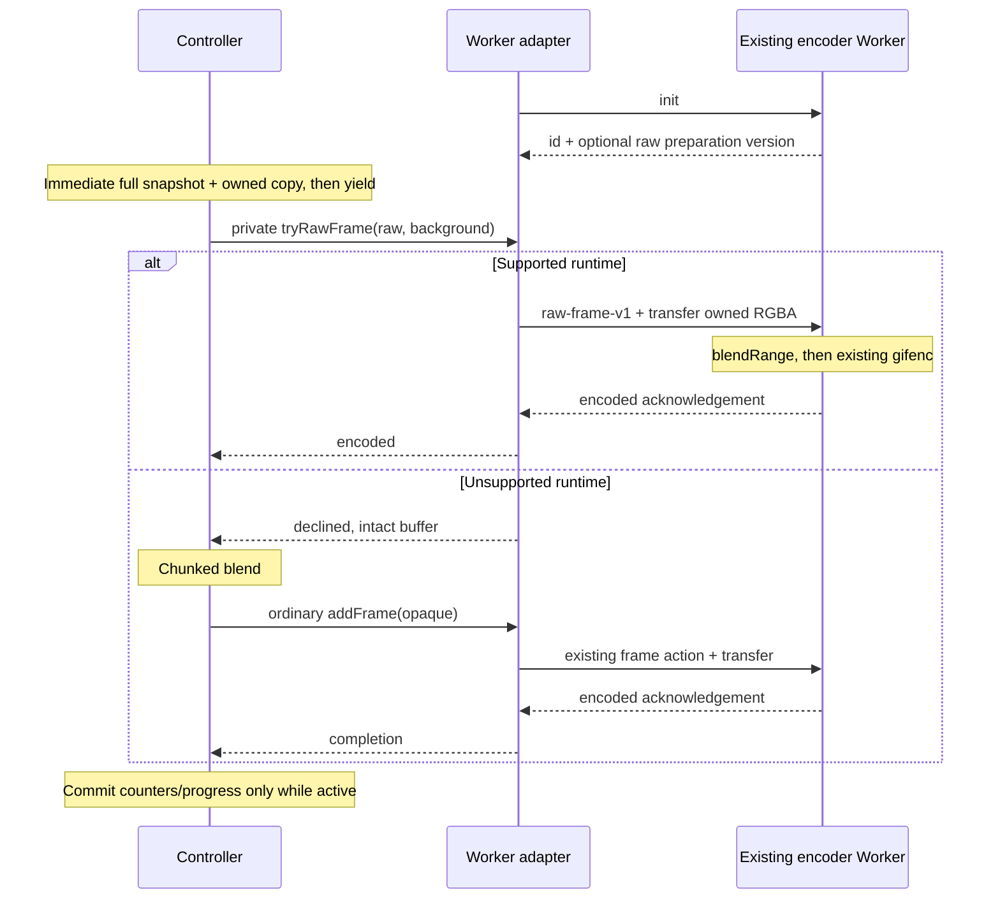

# GIF frame preparation latency: design draft

Status: Path A implemented locally, Path B remains a proposal, 2026-11-04. Based on commit `fe2f6f3`
and the [memory/cancellation report](../gif-memory-benchmark.md). The follow-up
[preparation comparison](../gif-preparation-benchmark.md) records implementation measurements.
The public GIF API and codec algorithms stay unchanged. Path A is included in release 0.6.0.

## Decision

Use two complementary paths, implemented and measured separately:

1. A shared, byte-identical compositing routine with cooperative chunks on the calling thread.
   This is the fallback for synchronous encoders, third-party adapters and older Worker runtimes.
2. An internally negotiated raw-RGBA path that composites in the **existing encoder Worker**,
   immediately before quantization. This is the preferred path for the supplied Worker adapter
   once compatibility and performance gates pass.

Keep the immediate, full canvas snapshot and owned copy. Do not introduce a second preparation
Worker, a Worker pool, a new public preparation interface or a new caller configuration option.
Chunk sizes, scheduling policy and the raw-frame protocol are implementation details.

## Evidence and limits

The previous benchmark measured cancellation from a scheduled deadline to operation settlement:

| 1280×720 probe | Sync median | Worker median |
| --- | ---: | ---: |
| Readback/snapshot boundary | 77.50 ms | 26.60 ms |
| Compositing boundary | 205.40 ms | 32.90 ms |
| Encoder entry | 115.70 ms | 1.00 ms |

After delivery of `abort()`, median settlement took about 0.0–0.2 ms. The opportunity is to let
that call execute sooner. These are **pipeline delays**: the compositing probe can include later
encoding and extra frames. The 205.40 ms value is not an isolated alpha-loop duration; 26.60 ms
is not a measured lower bound for canvas readback. Stage-level measurements are still needed.
The report also found higher sampled peak memory with Worker encoding; moving composition there
does not justify a memory-saving claim.

## Contracts to preserve

The controller in [gif.ts](../../src/gif.ts) currently reads the full canvas and clones its pixels
before its first `await`. The caller may immediately redraw or resize the canvas after calling
`addFrame()`. Both [snapshot tests](../../test/gif.test.mjs) and custom canvas-like test contexts
depend on owning that copy. Never transfer or modify the caller's pixel storage.

Readback and cloning remain an atomic synchronous prefix. Reading canvas tiles across yields could
combine different drawings in one frame. Removing the clone would require a separate ownership
decision for borrowed pixel arrays. Transferring the source canvas would change caller ownership;
`transferControlToOffscreen()` also rejects an HTML canvas with an existing rendering context.
See the [HTML canvas transfer algorithm](https://html.spec.whatwg.org/multipage/canvas.html#dom-canvas-transfercontroltooffscreen).
ImageBitmap/OffscreenCanvas capture alternatives need their own snapshot and color-conversion
study; they are outside this compatible optimization.

All ordinary `GifFrameEncoder.addFrame()` calls continue receiving fully opaque RGBA. Preserve:

- The alpha-255 fast path and, otherwise, `a = alpha / 255`,
  `Math.round(source * a + background * (1 - a))` per RGB channel, then alpha 255.
- A copy of the validated background at exporter creation; no deferred read of caller options.
- Dimension/duration/limit checks before readback, fixed dimensions after the first encoded frame,
  10 ms duration rounding, repeat behavior and sequential backpressure.
- Progress and counters only after a complete encoded-frame acknowledgement; no new progress phases.
- First failure/abort reason, one-time adapter cleanup and rejection of overlapping operations.
- Identical GIF bytes for identical inputs/settings with the same supplied codec version.

## Comparison

| Property | Cooperative composition on calling thread | Composition in encoder Worker |
| --- | --- | --- |
| Immediate snapshot/readback/copy | Still synchronous | Still synchronous |
| Alpha composition | Same work, divided across tasks | Same work, off calling thread |
| UI/cancel opportunity | Between chunks; depends on task scheduling | While Worker composes and encodes |
| Synchronous codec blocking | Remains for a synchronous adapter | Supplied codec already runs in Worker |
| Third-party encoder compatibility | Unchanged opaque frames | Requires private capability; otherwise fallback |
| Pixel transport | Existing adapter behavior after composition | One owned raw-buffer transfer; no round trip for pixels |
| Memory | Full owned snapshot remains; no per-chunk copies | Full snapshot remains; existing Worker overhead remains |
| Throughput risk | Clock checks and task overhead | Startup/transport and protocol validation overhead |
| Additional complexity | Scheduler lifetime and cancelled continuations | Negotiation, mixed asset versions and transfer ownership |

Chunking alone cannot bound end-to-end cancellation when quantization/LZW subsequently runs
synchronously. Worker preparation removes another calling-thread loop but cannot make the initial
snapshot interruptible. Neither path promises a fixed wall-clock cancellation deadline.

## Path A: cooperative preparation

Extract one synchronous `blendRange(data, startPixel, endPixel, background)` implementation used
by both paths. It mutates the owned snapshot in place, respects pixel boundaries and does not
allocate a new RGBA buffer per chunk. Changing integer rounding, palette logic or pixel order is
outside this work.

Retain a task boundary after snapshot acquisition, including for a small/opaque frame. After that,
process blocks until either the frame is complete or a private time/pixel budget is exhausted.
An initial experiment can compare 2/4/8 ms task budgets, checking the clock every 16,384 pixels
and enforcing a pixel ceiling per task. These are candidate settings, not chosen defaults or API.
Clock checks belong at block boundaries, not per pixel. A completed small frame needs no extra yield.
Slow blocks, GC and system scheduling can overshoot the budget; measure the maximum uninterrupted
preparation task instead of treating the budget as a guarantee.

Use a real task boundary. `Promise.resolve()`/microtasks do not provide the required return to
normal task processing. Nested zero-delay timers can be clamped to at least 4 ms, so compare
feature-detected `scheduler.yield()`, an owned MessageChannel, and `setTimeout(0)` as a portable
fallback. Scheduler continuations have priority semantics; task-source interleaving is browser
dependent. Neither scheduler nor MessageChannel should be assumed to let an already-due timer
run next. Test timer-driven and actual input-driven cancellation before selecting the policy.
See [HTML timers and microtasks](https://html.spec.whatwg.org/multipage/timers-and-user-prompts.html#timers)
and the [scheduling proposal](https://wicg.github.io/scheduling-apis/#dom-scheduler-yield).

Keep at most one scheduled continuation per exporter. A task gate owns timer IDs/MessagePorts
and settles its pending waiter on cleanup; closing a port or clearing a timer alone must not
leave the suspended operation unresolved. A scheduler continuation already queued by `yield()`
may still execute: its first action checks the terminal state and does no further work.

Store the current snapshot in a mutable owned frame slot. Clear that slot on success, error,
abort and disposal, including while suspended. Do not keep a second local pixel reference across
an `await` that defeats this release. Check active state before/after every continuation and
before adapter submission. A cancelled partially composited frame is never submitted and does
not increment progress. Once a synchronous codec call starts, chunk cancellation cannot interrupt it.

## Path B: raw preparation in the existing Worker

The public encoder interface has no preparation capability. Do not infer one from factory names,
`workerUrl`, constructor identity or the presence of `addFrame()`. Add an optional **private,
versioned capability on the created encoder instance**, leaving its declared public type unchanged.
The controller uses it only if present; ordinary adapters still receive opaque frames.

The independently built `/gif` and `/gif/worker` entries cannot rely on a module-local `Symbol()`
or WeakMap being shared after bundling. A non-enumerable property keyed by a versioned
`Symbol.for(...)` is the proposed internal bridge, with no public export or global strong-reference
registry. It is an optimization convention, not a security boundary or a supported plugin API.
Do not add codec imports to the controller or require a new shared runtime asset. A wrapper that
copies only public encoder methods loses this optimization and correctly uses the fallback.

At design time the build compiled the controller/transport with `tsc`. Path A now bundles the helper
into the controller; future Worker preparation must inline the same helper into that entry while
keeping `gifenc.js` external to its runtime as today. Verify emitted dependency graphs and public
declarations; a new bare helper import from `gif.js` would break the standalone-entry contract.

The private operation accepts the owned raw frame plus copied RGB background and resolves with
one of two outcomes:

| Outcome | Required meaning |
| --- | --- |
| `declined` | Runtime lacks the capability; buffer is intact and unmodified. Controller may composite in chunks and call ordinary `addFrame()` once. |
| `encoded` | Worker composited and encoded the frame and acknowledged it. Controller commits counters once and does not call ordinary `addFrame()`. |
| Rejection | Terminal operation failure. After transfer there is no retry/fallback using a detached buffer. |

The operation itself awaits initialization and checks negotiated support before any transfer.
This avoids a race between capability probing and buffer handoff. Abort/disposal while waiting
for initialization rejects pending work, and a late initialization reply must never post a frame.
The controller checks active state after every await, including after a decline.

Extend the existing init response with an optional `rawPreparationVersion: 1` capability. An older
runtime's `{ id }` reply or an unknown version selects fallback. A newer runtime keeps the current
opaque `frame` action for older adapters. The new action, provisionally `raw-frame-v1`, carries
dimensions, rounded duration, owned RGBA and background. Validate dimensions, safe expected byte
length, typed-array/buffer shape, duration and RGB bytes at the runtime boundary. Send only the
owned, full-span transferable ArrayBuffer, never caller storage or SharedArrayBuffer.

After transfer, ownership belongs to the Worker; no raw/opaque pixels are returned. Composition
can run synchronously there because terminating the owned Worker handles cancellation during
both preparation and encoding. Use the existing request timeout, listener/timer cleanup and
first-error behavior. A claimed capability followed by a malformed reply, timeout or transport
error is terminal, not a reason to encode the same frame again. Keep one in-flight frame and
the existing sequential controller; no extra queue, Worker or buffer pool.

## Verification and experiment design

Correctness gates are mandatory before considering speed:

- Byte-for-byte baseline/chunk/Worker GIF comparison plus independent decoding: opaque pixels,
  mixed alpha, gradients, alpha 0/1/128/254/255, non-white backgrounds, both quality modes,
  palette settings, repeat and varied rounded delays including the last frame.
- Mutation/resize immediately after `addFrame()`, caller buffer still attached, custom encoder
  seeing only opaque pixels, early dimension/limit failures and unchanged public type examples.
- Abort/dispose before capture, after snapshot, between chunks, during init, after transfer,
  during Worker blend/encode and finish; late continuation/reply, transport error and timeout.
  Preserve the first reason, no progress after termination, dispose exactly once, no unhandled
  rejections, and successful fresh exports after each failed/cancelled attempt.
- New adapter with old/custom runtime, old adapter with new runtime, unknown capability version,
  wrappers without the private capability, and duplicate bundled copies of the entry points.
- Zero owned Workers/listeners/timers/ports/pending requests after settlement. Check released
  snapshots while deliberately retaining disposed exporter handles as a new resource probe;
  the previous memory report released those handles and does not establish this case.
- Existing Node, real-browser, packed-consumer and Next.js checks; preserve standalone entries
  and a codec-free controller, with unchanged public declarations/exports.

Compare untouched baseline, chunks-only, and negotiated Worker preparation with chunk fallback.
Use identical deterministic opaque/mixed/gradient frames at 640×360, 1280×720 and 1920×1080,
short and long exports, the same settings, fresh encoders and separate warmups. Alternate paired
run order, include an unchanged A/A control and use at least five latency repetitions; increase
repeats when dispersion is comparable to the difference. Save machine/browser versions, raw
samples and settings. Do not turn local performance figures into shared-CI pass/fail thresholds.

Separate lightweight timing/cancellation runs, uninstrumented throughput runs and intrusive memory
sampling. Record readback and owned-copy time separately, blend CPU and maximum uninterrupted
preparation task, yield waits, Worker initialization/transfer/round-trip and Worker blend/codec
times. Use durations within each realm or normalized time origins, not subtraction of unrelated
`performance.now()` values. Keep deadline→abort delivery, abort→settled and actual Worker closure
as distinct metrics; report distributions and worst observed values, not only medians.

The initial tuning objective is approximately 4 ms preparation tasks after snapshot, with p95
under 8 ms on the reference machine. This is a provisional experiment target, not an acceptance
claim or API promise. Choose constants only after paired measurements show smaller preparation
stalls/cancellation delay without a material unexplained throughput or memory regression. Always
report the synchronous snapshot and codec times separately so a smaller blend task cannot hide
an unchanged end-to-end stall. Retain byte identity and cleanup as hard gates regardless of speed.

The current lifecycle benchmark needs adaptation before it can validate this design. Its encoder
wrapper copies only `addFrame`/`finish`/`dispose`, which would strip the private capability. Use a
transparent wrapper or explicit internal forwarding and assert which path actually ran. Its
cancellation bootstrap recognizes only the `frame` action; it must recognize `raw-frame-v1`
and mark preparation/encoding separately. Otherwise it could silently test the fallback or miss
the intended cancellation point. Keep normal memory runs on the shipped runtime asset.

## Implementation sequence and status

1. Completed locally: shared composition, cancellable chunk preparation and ownership tests;
   task schedulers/budgets and baseline compared with custom-adapter spies and real adapters.
2. Future, separately authorized: add the private bridge and version negotiation, raw Worker preparation and compatibility/fault
   tests. Fix benchmark observers and verify actual raw-path execution before comparing adapters.
3. Chunk timing/cancellation and cleanup comparison is recorded in the linked report. Extend it with
   raw Worker timing/memory before enabling that path; select settings from measured results and
   repeat package/browser checks. Sending changes to GitHub and checking CI is a separate request.

The separately requested Path A implementation inlines the shared helper into the standalone
controller and uses a 4 ms budget, 16,384-pixel blocks and a 1,048,576-pixel task ceiling. It keeps
the initial timer boundary, uses MessageChannel for subsequent chunks and timers when unavailable.
The measurements rejected scheduler continuations because the cancellation timer could be starved.
Path B, commits/push and releases still need their own request. Palette/dithering changes and other
roadmap stages do not start here.
