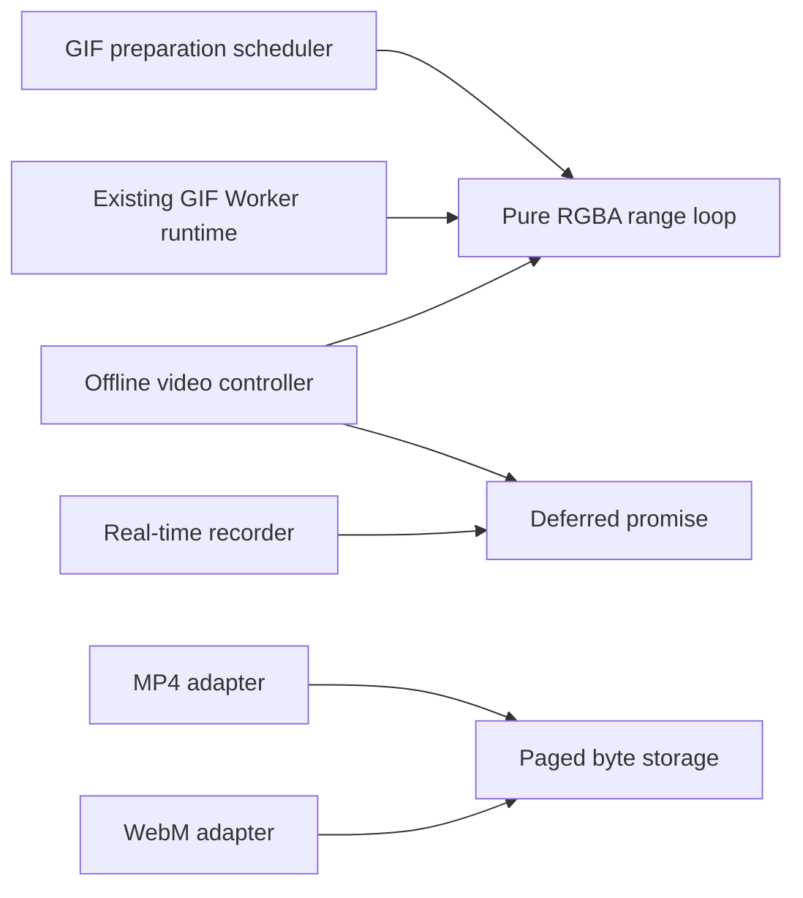

# Shared export mechanisms: design

Status: design established 2026-11-06; M1 RGBA extraction implemented locally after 0.6.0,
with [verification](shared-rgba-verification.md). [M2 evaluated](shared-deferred-evaluation.md):
extraction deferred; [M3 paged bytes implemented locally](shared-paged-bytes-verification.md). Baseline:
`7362c6c71c194e1c7165d83bcb428a2915b598ab` (Worker GIF preparation committed after release 0.6.0).
Public types/options/exports and package version remain unchanged.
The personal roadmap remains outside the repository. Acceptance gates are in the separate
[compatibility checklist](shared-export-compatibility.md).

## Decision

Share small mechanisms with demonstrated duplication, keeping the three controllers and their
format/clock policies separate. Start with the identical RGBA composition algorithm. Consider
the MP4/WebM paged byte store separately. The identical deferred-promise primitive was evaluated
and is kept local for now; its small duplication does not justify adding recorder bundling yet.
Each extraction must pass its own compatibility gate before another mechanism is moved.

There is no proposed public `Exporter`, universal frame union, unified state enum or common
encoder factory. GIF, offline video and real-time recording already expose different useful
contracts. Common rules for ownership and cancellation do not require identical state machines.

## Evidence in the current implementation

| Area | GIF | Offline video | Real-time recording |
| --- | --- | --- | --- |
| Controller | [gif.ts](../../src/gif.ts), synchronous factory | [video.ts](../../src/video.ts), asynchronous support/acquisition | [index.ts](../../src/index.ts), synchronous factory; capture starts in `start()` |
| Frame/time input | Immediate owned canvas snapshot, one duration in ms | Immediate owned snapshot, explicit contiguous `timestampUs`/`durationUs`; optional copied PCM | Live capture stream, supplied fps and optional cloned audio tracks |
| Time policy | Each frame rounded to 10 ms; repeat is playback metadata | Integer microseconds, sample-clock audio, explicit final hold | Active elapsed time excludes pauses; MediaRecorder owns encoded timestamps |
| Frame completion | `framesEncoded` increments after encoder/Worker acknowledgement | `framesAccepted` increments after input acceptance and audio feeding; output packets have separate counters | Browser events complete start/pause/resume/stop; no per-frame submission/progress API |
| Output | Encoder returns a complete Uint8Array; controller copies into `image/gif` Blob | Serial codec-event sink, then muxer returns complete Blob and result metadata | Accumulated `dataavailable` Blobs, assembled after final data and `stop` |
| Limit outcome | Rejected frame makes session failed; no partial GIF | Rejected frame/queue overflow makes session failed; no partial container | Active-duration limit initiates a successful stop with `stopReason: 'duration-limit'` |
| Scheduling | Initial timer yield; cooperative fallback or negotiated existing Worker | Synchronous composition before first frame yield; bounded audio input and independent output draining | MediaRecorder events, duration timer and resize/track-ended observation |

At the baseline, the [GIF preparation helper](../../src/gif-preparation.ts) defined `blendRange`;
its formula was duplicated inline in `video.ts`. M1 moves both to [one pure module](../../src/internal/rgba.ts).
`deferred<T>()` in `video.ts` and `index.ts` already has the same
promise/rejection-handling behavior. [MP4](../../src/video-mp4.ts) and
[WebM](../../src/video-webm.ts) each collect positioned writes into owned 65,536-byte pages,
track the maximum written endpoint and assemble a Blob at finalization. M3 now shares those storage
mechanics in [one internal module](../../src/internal/paged-bytes.ts), retaining adapter policies.

These are source observations at the baseline, not evidence that a generalized session engine
or output queue would improve either controller. The [Worker comparison](../gif-worker-preparation.md)
also shows a throughput/latency tradeoff and no consistent memory reduction; extraction alone
must not be described as a performance or memory optimization.

## Frame and clock domains

Keep the existing public descriptions unchanged. Internally, distinguish the following facts
instead of converting every input to a new universal frame object:

| Domain | Validation/commit rule | Policy owner |
| --- | --- | --- |
| GIF duration | Validate 10..655350 ms, round each duration with `Math.round(ms / 10) * 10`, check limits before readback; commit duration/count after encoded acknowledgement | GIF controller |
| Video interval | Nonnegative safe-integer start, positive safe-integer duration/end, first start zero, next start equals prior accepted end; no gaps/overlaps | Offline video controller |
| Audio position | Absolute sample offset, rescaled with safe integer arithmetic; target samples are nearest integer to `videoEndUs * sampleRate / 1e6` | Offline video controller and audio adapter |
| Coded packet | Signed timestamps may express audio priming; current protocol has no video reordering; decoder config and track-end trimming remain explicit | Codec adapters and video protocol validation |
| Container time | Rescale absolute boundaries before taking deltas; reject collapsed/unrepresentable intervals | Container adapters: MP4 57,600 Hz video ticks; WebM microsecond timebase |
| Capture time | Account active wall time from browser events, exclude pauses; do not synthesize offline intervals from fps | Recorder |

No shared duration accumulator or fps-to-time conversion is proposed. GIF's rounded delay, video
intervals, signed packet time and audio sample counts have different validation and rounding needs.
In particular, `frameRateHint` stays a hint and GIF repeats do not consume the duration limit.
MP4 edits and shortened final AAC sample durations, and WebM CodecDelay/DiscardPadding, stay in
their adapters. Existing raw-decoder endpoint/trim limitations remain documented in the
[AAC](../offline-aac.md) and [WebM](../offline-webm.md) guides.

## Ownership boundaries

| Resource | Ownership and release boundary |
| --- | --- |
| Caller canvas and readback storage | Never transfer the canvas, detach caller buffers or modify caller pixels. Offline capture makes its own full copy before the first asynchronous yield. A tiled snapshot across yields is a different contract. |
| Owned RGBA copy | One controller-owned snapshot per accepted in-progress operation. Ordinary GIF encoders receive opaque pixels; the supplied private raw path may transfer the owned copy. Video receives an owned opaque frame. Cancellation drops controller references and closes owned work. |
| Prepared PCM | Validate and copy before the first initialization await; retain session-owned source planes, send independent bounded blocks, release retained planes at terminal cleanup. Caller channels remain usable. |
| Codec events | The video sink copies packet/config bytes before asynchronous muxing. Its returned promise acknowledges muxer consumption, not arrival at the sink. Borrowed adapter bytes can be reused after that promise settles. |
| Created adapters and native inputs | Session owns fresh encoder/muxer instances; native adapters close temporary VideoFrame/AudioData objects. Factories remain caller-owned. Video must dispose instances resolving after cancellation too. |
| Tracks | Recorder owns captured video and audio clones, removes listeners and stops those tracks. Caller audio originals remain live. Do not reuse the offline adapter registry as a track policy. |
| Output storage | Encoder/muxer/session retains unfinished output; successful Blob belongs to the caller. Cleanup must not invalidate a previously returned Blob. Releasing references is not a promise of immediate native/GC reclamation. |

Preserve the existing readback calls: GIF uses its current default `getImageData` call, whereas
offline video explicitly requests `colorSpace: 'srgb'`. Composition sharing must not change that
choice, input validation order, copy count or the synchronous prefix of `addFrame()`.

## Proposed internal modules

The following paths and signatures describe internal boundaries. They are not package entry points
or supported deep imports. M1/M3 are implemented locally; M2 extraction is deferred after evaluation.

### M1. Pure RGBA composition

Implemented home: [src/internal/rgba.ts](../../src/internal/rgba.ts), containing the existing
`blendRange(data, startPixel, endPixel, background): void` algorithm.

- Operate only on a caller-specified range of an already-owned Uint8ClampedArray.
- Preserve alpha-255 RGB bytes exactly; otherwise use `alpha / 255`, per-channel
  `Math.round(source * alpha + background * (1 - alpha))`, then set alpha to 255.
- Add no allocation, snapshot, validation, global/browser access, task scheduling or cancellation.
  Input/range validation remains at the current controller/protocol boundary.
- GIF preparation calls it in the existing chunks; GIF runtime calls it for a complete raw frame;
  video calls it synchronously for the complete snapshot at the same position as its inline loop.
- Keep GIF scheduler constants, initial yield, active guards and raw negotiation unchanged.
  Moving video composition to a Worker or making it cooperative requires a separate change.

This first implementation slice removes a duplicate algorithm while preserving the two existing
scheduling policies. See [M1 verification](shared-rgba-verification.md) and gates K2, K3, K9 and K11
in the checklist.

### M2. Deferred promise

Evaluation complete: [decision and compatibility evidence](shared-deferred-evaluation.md).
Keep the current local helpers. The boundary below describes a possible later extraction, not
an implemented module. Reconsider when another justified change already needs recorder bundling
or repeated maintenance drift gives a concrete benefit.

Proposed home: `src/internal/deferred.ts`, matching the existing `deferred<T>()` in video/recorder.
It creates one original promise and exposes its native resolve/reject functions. Attach the existing
ignored rejection handler to that original promise; return the original promise, not a caught or
wrapped replacement. Do not add `async`, scheduling, state transitions, error conversion or timers.

Use only at identical existing call sites, after characterization of promise identity and
reentrancy. Keep GIF's cancellation reason/state policy local rather than replacing it with a
new session abstraction. Native Promise settlement already prevents repeated resolution; this
helper does not decide which public outcome or error should win. See gates K5, K6 and K9.

### M3. Paged in-memory bytes for MP4/WebM

Implemented home: [src/internal/paged-bytes.ts](../../src/internal/paged-bytes.ts), with
[verification](shared-paged-bytes-verification.md). Limit it to positioned copying, high-water length,
ordered used-page views and clearing owned pages. Preserve 65,536-byte pages, synchronous copying,
last-write-wins overlapping updates, and Blob assembly without an extra contiguous full-file copy.
Data passed to a positioned write is borrowed only for that synchronous call.

Keep these policies in each adapter:

- Format/MIME, container setup, track timing, metadata and final timeline validation.
- `reserve()` media-payload accounting plus actual `maxOutputBytes` checks including headers.
  A rewrite is checked by its endpoint; file size is a high-water mark, not total write traffic.
- First output error and existing format-specific error messages; check the budget before allocating
  rejected pages. A page can be larger than the remaining logical file bytes, as it is today.
- Disposed/aborted/error guards on queued vendor writes. Such writes must not repopulate pages;
  the vendor's owned stream must still be allowed to close. Do not replace this with a thrown
  observer error: current target observers do not propagate errors to the calling operation.
- Signal registration/removal, vendor cancellation and asynchronous error propagation.

The byte store does not know codec events, AbortSignal, Mediabunny or public progress. Adapter guards
decide when it can be used and cleared; it does not introduce another lifecycle. Preserve actual
writer coverage and rewind traces. Arbitrary sparse-file/zero-fill semantics are outside this
extraction and must not be silently added. GIF's complete Uint8Array and recorder Blob chunks
should keep their current storage rather than taking an extra paged copy. See gates K7 and K12.

### Build boundary

The currently standalone `index.js`, `video.js`, `gif.js` and `gif-worker.js` must remain standalone.
The GIF runtime must keep only its existing `gifenc.js` runtime import. Helper extraction must not
create a required `internal/*.js` deployment asset, load a codec through a controller, or change a
Worker URL/protocol. No shared singleton, registry, Worker pool or browser-global access at import.

At the baseline, [build-adapters.mjs](../../scripts/build-adapters.mjs) bundled the GIF entries,
while TypeScript emitted standalone recorder/video files without runtime imports. M1 also bundles
`video.js` to inline the new helper. The recorder remains unchanged. Any later helper imports need
the same standalone-output verification for their affected entries.
Keep generated public declarations free of internal helper imports. Small pure helpers may be
inlined into independently loaded bundles; avoid a shared runtime chunk dependency for them.
The existing MP4/WebM vendor chunks and license/source packaging remain separate and intact.

This is the proposed dependency graph after separately accepted slices, not the current file graph.
State transitions, timing, progress construction and queue policy remain in the boxes on the left.

## Shared rules without a shared session engine

### Operation admission and finalization

| Behavior | GIF | Offline video | Recorder |
| --- | --- | --- | --- |
| Overlapping input | Reject while `encoding`, leave accepted work running | Reject while `encoding`, leave accepted work running | No input method; start is one-shot; pause/resume have event-backed pending transitions |
| Finalization state | Public state remains `encoding`; progress uses `finalizing` | Public state is `finalizing` | `stopping` until final data/stop event |
| Repeat completion | `finish()` during/after completion rejects; no cached-success finish contract | Repeat `finish()` during finalizing/finished returns the same promise/result | Repeat `stop()` shares its stop promise; `finished` observes result without initiating stop |
| Disposal reason | AbortError for unfinished work | AbortError for unfinished work | Existing Error for unfinished recording |
| Failed state | `failed` | `failed` | `stopped`, with rejected result |

A generic `runOperation`/`finishOnce`/terminal-state enum would erase these distinctions. Keep their
policy local. Any later common cancellation primitive must first demonstrate the same admission,
promise identity, error/cause and synchronous ordering in all intended consumers; it is not part
of the initial extractions.

### Cancellation, failure and resource release

For offline exports, preserve prompt rejection of pending operations after delivered cancellation,
existing signal-reason/default-error behavior, and guards after asynchronous boundaries. Synchronous
readback, GIF sync encoding and native execution cannot be preempted by a promise race. Terminate
owned Workers, dispose owned adapters, cancel scheduled preparation tasks and remove signal listeners.
Do not retry a transferred raw GIF buffer. Supplied adapters are released once even if cleanup throws;
video also accounts for late async acquisitions. Keep cleanup errors from replacing the primary
operation outcome and suppress late packets/progress/rejections after a terminal outcome.

Recorder cleanup remains tied to native events and owned tracks. Preserve stop/transition races,
final chunk inclusion, active-time accounting and partial track-clone failure handling. Its public
surface has no AbortSignal option or offline cancellation protocol. New common helpers cannot add one
or impose offline adapter-disposal call counts on native track cleanup.

### Progress and observers

Build each frozen snapshot in its controller at the existing commit point and invoke observers
synchronously with ignored observer exceptions. Keep optional property presence, counter names,
units and phase sequence. Cancellation/disposal requested by an observer must still be honored at
the existing guards; do not queue callbacks into another task or batch them.

GIF encoded-frame counts must not become video-style accepted counts. In video, packet counters can
advance before the corresponding public `addFrame()` succeeds; audio can be partially accepted before
a later failure. Do not turn all those counters into one atomic frame commit or a derived percentage.
Once success is committed, disposal from a finished observer must not retract the returned result.
Recorder has no public progress observer. Shared progress types/reporting are deferred; a generic
notification wrapper offers little benefit until ordering/reentrancy characterization exists.

### Queues and limits

Keep GIF's one outstanding public operation and Worker requests; do not introduce pipelined frames.
Keep video's per-track config/packet/end validation, copied output events, global serial muxer writes,
and independent draining during creation/input/flush. A write must not wait for a future track packet.
Keep raw snapshot and input look-ahead checks before readback, plus the existing payload/description
bytes + 64 bytes per queued event reservation, including in-flight writes and zero-byte events.
Do not merge the separate adapter and controller budgets into a single fictitious heap limit.

No reusable cross-format queue is proposed: GIF has no codec-event queue, and MediaRecorder's native
event production cannot be backpressured by this API. Their buffers and clocks have different owners.
Display hints remain hints. A common numeric validator must not reorder checks, change error types/
messages or add new limits to a previously valid path; validation sharing is deferred.

## Result storage and a future external receiver

The compatible result boundary stays a complete Blob (GIF) or existing immutable result containing
a Blob (video/recorder). Byte storage M3 makes two current adapters simpler; it does not change
the whole-file memory cost or add streaming export. `CodecOutputSink.write` consumes codec events,
not finished-file chunks. A vendor `StreamTarget` writing into owned pages is still in-memory output.

An external receiver needs a separate design/API decision. Before proposing an opt-in public target,
establish these requirements:

| Requirement | Decision needed for a later target proposal |
| --- | --- |
| Write capabilities | Distinguish append-only from positioned/seekable writes; MP4/WebM currently expose positioned writes and rewrites. Do not claim any arbitrary append-only stream can host both current containers. |
| Acknowledgement/ownership | Define when borrowed chunk bytes may be reused, bounded outstanding writes and whether a receiver is caller-owned. Never close a caller-owned file implicitly. |
| Commit/abort | Define finalization, abort/failure cleanup and responsibility for partial output; a closed or partially written file is not a successful video result. |
| Limits and metadata | Check logical high-water output size including headers; report valid MIME/codecs/timeline only after commit; decide how a non-Blob result is represented. |
| Profile/support | Verify each container's capability/rewind needs and error propagation with an actual file/receiver, including slow writes and storage-full errors. |

Current custom muxers may choose their own storage but must still honor the existing complete-Blob
contract. No external target option, result variant or universal writer interface is introduced here.
Calling `Blob.stream()` after finalization does not establish bounded-memory export.

## Implementation sequence and completion gates

1. **Characterize the baseline** using [K1–K12](shared-export-compatibility.md). Freeze declarations,
   runtime export lists, state/promise/observer traces, representative files and actual vendor write
   traces. Mark missing tests as pending; an existing broad test is not proof of every new assertion.
2. **M1 implemented locally**, with only the required build changes. Video stays synchronous and
   both GIF paths remain selected as before. See byte/range, snapshot, real-file, Worker compatibility
   and packaging evidence in [M1 verification](shared-rgba-verification.md).
3. **M2 evaluated: extraction deferred.** An isolated candidate preserves the checked promise/error/
   order contracts, but the build cost outweighs the small duplication. Keep the new characterization
   tests; see the [decision](shared-deferred-evaluation.md) for conditions to reconsider.
4. **M3 implemented locally** after output-write characterization. Adapter policies remain local;
   rewinds, bounds, failed/late writes, Blob independence and real A/V containers are checked in
   [M3 verification](shared-paged-bytes-verification.md).
5. **Reassess remaining duplication**. Session gates, clocks, queues and progress types need a concrete
   second compatible use case and evidence before abstraction. External receivers require their own
   target/result proposal. APNG/WebP can later reuse pure mechanisms without inheriting video clocks.

Each implementation slice needs its own report of changed behavior (ideally none), compatibility
evidence and any performance tradeoff. New tests should target the moved mechanism and observable
contracts. Do not introduce load-dependent timing/memory thresholds in shared CI. A failed gate means
fixing or reverting that slice, not relaxing a contract or silently falling back to a different codec.
Commit, push and publishing remain separate user requests; this document authorizes none of them.

## Initial design validation and follow-up

This proposal was checked against the linked baseline source, existing unit/browser tests, build
script and package exports. The accompanying checklist separates existing coverage from required
characterization and implementation-time checks. It does not claim those future checks have run.
The initial design task changed documentation only. The later M1 extraction changes its listed
runtime consumers/tests/build, with evidence in [M1 verification](shared-rgba-verification.md).
The [M2 evaluation](shared-deferred-evaluation.md) adds public-contract tests and retains both local
helpers. [M3 verification](shared-paged-bytes-verification.md) records the shared output-store extraction.
Package metadata/lockfile, public API and version remain unchanged; M2 is not implemented.
